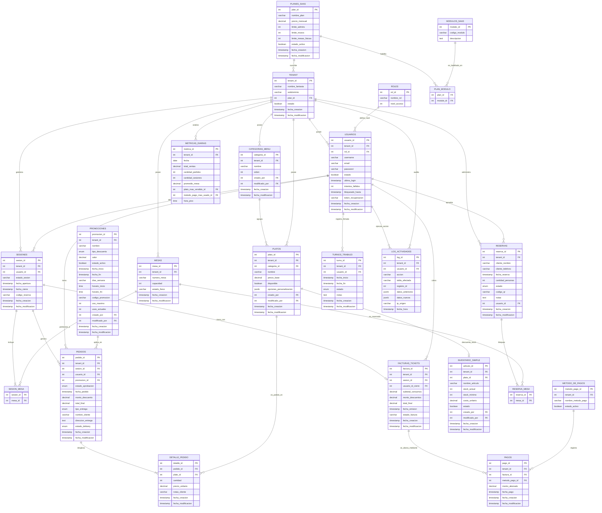

# DER - SaaS Gastronómico

## BASES CENTRALES (Estructura Core para cualquier SaaS)

### 1. TENANT (Organizaciones)

La raíz absoluta del sistema. Representa al cliente/restaurante que contrata el servicio. Todas las tablas operativas dependerán de esta.

- **tenant_id** (PK)
- **nombre_fantasia**: VARCHAR(100) - Nombre público del local (ej: "Mostachos").
- **subdominio**: VARCHAR(100) - Ruteo dinámico para el frontend (ej: "mostachos-baby").
- **plan_id** (FK): Vincula la suscripción contratada por el cliente.
- **estado**: BOOLEAN - Baja lógica.
- **fecha_creacion** TIMESTAMP.
- **fecha_modificacion** TIMESTAMP.

### 2. ROLES (Catálogo de Accesos)

Define los niveles de acceso estáticos del sistema.

- **rol_id** (PK): Identificador único.
- **nombre_rol**: VARCHAR(50) - Ej: 'Dueño', 'Administrador', 'Cajero', 'Mozo'.
- **nivel_acceso**: INT - Jerarquía numérica para control en las rutas del backend y renderizado del frontend.
- **fecha_creacion** TIMESTAMP.
- **fecha_modificacion** TIMESTAMP.

### 3. USUARIOS (Control de Acceso)

Aquí conviven los dueños, administradores y el personal del salón.

- **usuario_id** (PK)
- **tenant_id** (FK): Obliga al usuario a existir únicamente dentro de su respectivo restaurante.
- **rol_id** (FK): Apunta al nivel de permisos del usuario.
- **username**: VARCHAR(50)
- **email**: VARCHAR(100)
- **password**: VARCHAR(255)
- **estado**: BOOLEAN - Baja lógica
- **ultimo_login** TIMESTAMP.
- **intentos_fallidos** INT DEFAULT 0.
- **bloqueado_hasta** TIMESTAMP.
- **token_recuperacion** VARCHAR(255).
- **fecha_creacion** TIMESTAMP.
- **fecha_modificacion** TIMESTAMP.

---

## GESTIÓN DE SUSCRIPCIONES Y LÍMITES (Base Gastronómica)

### 4. PLANES_SAAS (Niveles Comerciales)

Define los niveles de suscripción y los topes cuantitativos de recursos que el plan permite.

- **plan_id** (PK)
- **nombre_plan**: VARCHAR(50) - Ej: "Básico", "Premium".
- **precio_mensual**: DECIMAL(10,2)
- **limite_admins**: INT - Cantidad máxima de cuentas con rol Administrador/Dueño.
- **limite_mozos**: INT - Cantidad máxima de cuentas con rol Mozo.
- **limite_mesas_fisicas**: INT.
- **estado_activo**: BOOLEAN - Baja lógica.
- **fecha_creacion** TIMESTAMP.
- **fecha_modificacion** TIMESTAMP.

### 5. MODULOS_SAAS (Catálogo de Funcionalidades Programables)

Registro estático de las funciones del software.

- **modulo_id** (PK): Identificador único relacional.
- **codigo_modulo**: VARCHAR(50) - Clave inmutable que lee Node.js (Ej: 'RESERVAS_WEB', 'UNION_MESAS', 'PAGOS_QR').
- **descripcion**: TEXT - Explicación interna de la funcionalidad.

### 6. PLAN_MODULO (Tabla Intermedia)

- **plan_id** (FK): PK Compuesta.
- **modulo_id** (FK): PK Compuesta.

---

## MÓDULO GASTRONÓMICO (Capa Operativa del Salón)

### 7. MESAS

Representa la disposición física del salón. No almacena consumos, solo el inventario de lugares.

- **mesa_id** (PK)
- **tenant_id** (FK)
- **numero_mesa**: VARCHAR(10) - Permite letras si el local usa sectores (ej: "A1", "12").
- **capacidad**: INT - **(DEBATIR)** Cantidad de comensales que entran en la mesa | Cantidad de comensales actual en dicha mesa.
- **estado_fisico**: VARCHAR(20) - Ej: 'libre', 'ocupada'.
- **fecha_creacion** TIMESTAMP.
- **fecha_modificacion** TIMESTAMP.

> **OBSERVACIONES PARA DEBATE:**
>
> - **Capacidad de las MESAS:** Conviene establecer la cantidad de personas que puede tener la mesa? Creo que puede ser 2 o 4, ya que pueden sentarse muchas más personas que solamente esten tomando algo y no con platos de comida `capacidad NULLEABLE`
> - **estado_fisico:**
>   > - Podemos dejarlo con un tipo de dato `ENUM ['libre', 'ocupada']` , para evitar cambios de estado constante.
>   > - Podemos programarlo que al pagar la cuenta, automaticamente se ponga en estado `SUCIA`.
> - **observacion** Podemos agregar este campo para describir si hay alguna falla, como pata rota, o algun desperfecto que se le encuentre.

### 8. SESIONES

Desvincula el consumo de la mesa física, permitiendo unificar mobiliario para grupos grandes. Ej: '2 o más mesas para X personas donde sólo se va a cobrar 1 solo monto.'

- **sesion_id** (PK)
- **tenant_id** (FK)
- **usuario_id** (FK) - Mozo que físicamente ve que ocuparon la mesa y aparta o confirma en el sistema que esa mesa si esta ocupada.
- **estado_sesion**: VARCHAR(20) - Ej: 'abierta', 'cerrada', 'reservada'.
- **fecha_apertura**: TIMESTAMP - Momento en que los clientes se sientan.
- **fecha_cierre**: TIMESTAMP (Nullable) - Momento en que se paga la cuenta.
- **codigo_reserva**: VARCHAR(20) (Nullable) - Si la sesión proviene del Módulo de Reservas, aquí se valida el código QR de entrada.
- **fecha_creacion** TIMESTAMP.
- **fecha_modificacion** TIMESTAMP.

> **OBSERVACIONES PARA DEBATE:**
>
> - **comensales_asignados** Podemos estableces este campo para poner o no la cantidad de personas que estén ocuapdo la mesa o el grupo de mesa `NULLEABLE` ya que si hay una cantidad muy concurrida de personas y el personal no da abasto, estar atento a rellenar este campo exactamente con el numero de personas que estan en la sesion seria muy molesto, estimar cantidad o si alguien que reserva las mesas, puede poner o tambien estimar que es X cantidad de personas van a estar.
> - La sesion no sera atendido por un único mozo, no vinculamos ningún usuarion con ella, la sesion se abre cuando el pedido se hace y se confirma, por ende tenemos la info de los mozos que estan involucrados en todos los pedidos aceptados de una sesion en particular
> - **Cliente escanea el QR:**
>   1. Si la mesa no está reservada el QR va a hacer que esa sesion se abra.
>   2. El mozo verifica físicamente del pedido de abrir la sesion, entonces el estado de la sesion pasa a 'abierta'.
>   3. Se cambia el estado físico de las mesas a 'ocupada'.

### 9. SESION_MESA (Tabla Intermedia)

Aqui es donde permitimos ocupar una o más mesas físicas para 1 sesion.

- **sesion_id** (FK): PK Compuesta.
- **mesa_id** (FK): PK Compuesta.

### 10. CATEGORIAS_MENU

Clasificación para estructurar el catálogo digital.

- **categoria_id** (PK)
- **tenant_id** (FK)
- **nombre**: VARCHAR(50) - Ej: "Hamburguesas", "Pizzas", "Bebidas".
- **orden**: INT - Define en qué posición aparece dicha categoria en la app del cliente (ej: 1ero mostramos las Bebidas, 2do mostramos la Hamburguesas, 3ero Mostramos las Pizzas, etc).
- **creado_por** (FK a USUARIOS) -- Quién creó el registro
- **modificado_por** (FK a USUARIOS) -- Última modificación
- **fecha_creacion** TIMESTAMP.
- **fecha_modificacion** TIMESTAMP.

### 11. PLATOS (Catálogo Dinámico)

Vamos a utiliza las ventajas de PostgreSQL para evitar exceso de tablas relacionales en ingredientes.

- **plato_id** (PK)
- **tenant_id** (FK)
- **categoria_id** (FK)
- **nombre**: VARCHAR(100)
- **precio_base**: DECIMAL(10,2)
- **disponible**: BOOLEAN - Permite al administrador ocultar platos sin stock.
- **opciones_personalizacion**: JSONB - Campo no estructurado para guardar filtros y variantes (Ej: `{"alergenos": ["Sin TACC"], "extras": ["Extra Cheddar", "Sin Cebolla"]}`).
- **creado_por** (FK a USUARIOS) -- Quién creó el registro.
- **modificado_por** (FK a USUARIOS) -- Última modificación.
- **fecha_creacion** TIMESTAMP.
- **fecha_modificacion** TIMESTAMP.

> **OBSERVACIONES PARA DEBATE:**
>
> - **stock_id:** Podemos realcionarlo `FK nulleable` ya que puede ser o no algo envasado o echo en pocos stock como postres o platos especiales.

### 12. PEDIDOS (Cabecera de Comanda)

Representa la acción del cliente de enviar un conjunto de platos a la cocina o barra. Con el vínculo del responsable (Mozo) de cada pedido aceptado, independientemente de quién sea el "Mozo" de la sesión.

- **pedido_id** (PK).
- **tenant_id** (FK).
- **sesion_id** (FK) - A qué cuenta (grupo de clientes) pertenece este consumo.
- **usuario_id** (FK) - El mozo que tomó y confirmó esta comanda específica, ya que varios mozos pueden tomar los distintos pedidos de una sesion o mesa.
- **promocion_id** (FK, Nullable): Se asocia si este pedido en particular recibió un descuento.
- **estado_aprobacion**: ENUM - Validación Human: 'pendiente_revision', 'rechazado', 'en_preparacion', 'entregado'. Aqui entra la accion del mozo/administrador que esta validando físicamente si dicho pedido es real o no.
- **fecha_pedido**: TIMESTAMP.
- **monto_descuento**: DECIMAL(10,2).
- **total_final**: DECIMAL(10,2) - sumatoria de ítems menos el descuento.
- **tipo_entrega** ENUM ['local', 'delivery', 'retiro'].
- **nombre_cliente** VARCHAR(50) NULL.
- **direccion_entrega** TEXT NULL.
- **estado_delivery** ENUM ['preparando', 'en_camino', 'entregado', 'cancelado'].
- **fecha_creacion** TIMESTAMP.
- **fecha_modificacion** TIMESTAMP.

> **OBSERVACIONES PARA DEBATE:**
>
> - Podemos acomodar en una COLA según sea aceptada la orden, estimar el tiempo aprox. de otros pedidos anteriores de la casa, o también calcular ni bien la comanda de cocina arranque a preparar ese pedido que aceptó ese sector.
> - Hay que pensar mejor con respecto al DELIVEY, si crear tabla aparte porque agregandole este campo, suma muchos campos para asegurar el delivery, ya sea direccion, cliente, estado, y si pasa algo, una observacion tambien viene bien.
> - No sé si conviene enredarnos con la tabla zonas y eso, ya que la app va a tener relevamiento de comidas del local y no tanto de cosas como qué barrio o calle es la que más pide.
> - Crear modulo de DELIVERY aparte.

### 13. DETALLE_PEDIDO

El desglose de cada plato pedido dentro de una comanda.

- **detalle_id** (PK)
- **pedido_id** (FK)
- **plato_id** (FK)
- **cantidad**: INT.
- **precio_unitario**: DECIMAL(10,2) - Se guarda para el histórico, para hacer métricas a futuro, pero el recibo de hoy no se altera.
- **notas_cliente**: VARCHAR(255) - Ej: "La carne bien cocida", "Sin sal".
- **fecha_creacion** TIMESTAMP.
- **fecha_modificacion** TIMESTAMP.

### 14. PROMOCIONES (Motor de Descuentos y Marketing)

Catálogo dinámico automatizado. Permite programar promociones para que se activen y desactiven solas según el día o la hora.

- **promocion_id** (PK)
- **tenant_id** (FK)
- **nombre**: VARCHAR(100) - Ej: "Miércoles 20% Off", "Happy Hour Cervezas".
- **tipo_descuento**: ENUM - ['porcentaje','monto_fijo'].
- **valor**: DECIMAL(10,2) - Ej: 20.00 (para 20%).
- **estado_activo**: BOOLEAN - Apagado manual.
- **fecha_inicio**: TIMESTAMP (Nullable) - Cuándo arranca la campaña.
- **fecha_fin**: TIMESTAMP (Nullable) - Cuándo termina.
- **dias_semana**: VARCHAR(50) - Ej: '1,2,3' (Lunes, Martes, Miércoles).
- **horario_inicio**: TIME (Nullable) - Ej: '18:00'.
- **horario_fin**: TIME (Nullable) - Ej: '21:00'.
- **codigo_promocion**: VARCHAR(20) UNIQUE (Nullable) - Ej: 'VERANO20' (Para campañas de Instagram).
- **uso_maximo**: INT (Nullable) - Ej: "Solo para los primeros 50 clientes".
- **usos_actuales**: INT DEFAULT 0 - Contador para validar el límite anterior.
- **creado_por** (FK a USUARIOS) -- Quién creó el registro.
- **modificado_por** (FK a USUARIOS) -- Última modificación.
- **fecha_creacion** TIMESTAMP.
- **fecha_modificacion** TIMESTAMP.

> **OBSERVACIONES PARA DEBATE:**
>
> - **Lo que aprobamos:** Al tener fechas, horarios y cupones evita que el mozo tenga que acordarse de hacer el descuento del Happy Hour; el sistema leerá la hora actual y lo aplicará solo.
> - Hacemos que todas las promociones apliquen al **TOTAL DE LA FACTURA**.

## MÓDULO DE FACTURACIÓN Y PAGOS (Cierre de Cuenta)

### 15. FACTURAS_TICKETS (Resumen de la Cuenta)

Se genera en el momento exacto en que el cliente "Pide la cuenta" o el mozo la imprime. Congela los montos finales de toda la sesión para el registro contable.

- **factura_id** (PK).
- **tenant_id** (FK).
- **sesion_id** (FK).
- **usuario_id_cierre** (FK) - El cajero o mozo que generó el ticket y recibió el pago.
- **subtotal_consumos**: DECIMAL(10,2) - Sumatoria total de todos los pedidos de la sesión.
- **monto_descuentos**: DECIMAL(10,2) - Sumatoria de todos los descuentos aplicados.
- **total_final**: DECIMAL(10,2) - Lo que realmente se debe cobrar (Subtotal - Descuentos).
- **fecha_emision**: TIMESTAMP - Cuándo se generó el ticket.
- **estado_factura**: VARCHAR(30) - Ej: 'pendiente_pago', 'pagada', 'anulada'.
- **fecha_creacion** TIMESTAMP.
- **fecha_modificacion** TIMESTAMP.

### 16. PAGOS

Registra el ingreso real del dinero. Al estar en una tabla separada (relación 1 a Muchos con la factura), permite que una misma cuenta se pague con múltiples métodos (ej: $10.000 en efectivo y $40.000 con MercadoPago).

- **pago_id** (PK)
- **tenant_id** (FK)
- **factura_id** (FK): A qué ticket contable pertenece este ingreso.
- **metodo_pago_id** (FK)
- **monto_abonado**: DECIMAL(10,2) - La cantidad de dinero que ingresó en este pago específico.
- **fecha_pago**: TIMESTAMP - Momento exacto de la transacción.
- **fecha_creacion** TIMESTAMP.
- **fecha_modificacion** TIMESTAMP.

### 17. METODO_DE_PAGOS

- **metodo_pago_id** (PK)
- **tenant_id** (FK)
- **nombre_metodo_pago**: VARCHAR(50) - Ej: 'Efectivo', 'MercadoPago', 'Tarjeta de Débito'.
- **estado_activo**: BOOLEAN - Baja lógica

### 18. INVENTARIO_SIMPLE

Se enfoca en productos que se compran y se venden en la misma unidad, o que requieren un conteo estricto de seguridad.

- **articulo_id** (PK)
- **tenant_id** (FK)
- **plato_id** (FK, Nullable): Vincula este inventario directamente con un producto del menú (ej: Si se vende el plato "Lata Coca-Cola", se descuenta 1 de aquí).
- **nombre_articulo**: VARCHAR(100) - Ej: "Botella Vino Rutini", "Porción Tiramisú".
- **stock_actual**: INT - Cantidad física disponible en el local.
- **stock_minimo**: INT - El umbral de alerta (Ej: Si llega a 10, el sistema avisa que hay que comprar más).
- **costo_unitario**: DECIMAL(10,2) - Cuánto le cuesta al restaurante comprar esa unidad (permite calcular la ganancia neta rápida).
- **estado**: BOOLEAN - Baja lógica.
- **creado_por** (FK a USUARIOS) -- Quién creó el registro.
- **modificado_por** (FK a USUARIOS) -- Última modificación.
- **fecha_creacion** TIMESTAMP.
- **fecha_modificacion** TIMESTAMP.

> **OBSERVACIONES PARA DEBATE:**
>
> - **`COSTO PROMEDIO PONDERADO`** averiguar sobre este tema. Ya que si tenemos 10 cervezas que las compramos a $1.000 y luego compramos 10 nuevas a $2.000, el campo de precio unitario con el del precio de venta se tiene que actualizar automáticamente a $1.500 o aprox. Se tiene que calcular la rentabilidad en base a este promedio.
> - Hay que abordar un inventario simple, para bebidas o platos tipo postres que se compran envasados o se preparan una X cantidad poque se echan a perder.
> - Agregar tabla INVENTARIO MOBILIARIO

### 19. RESERVAS

No va a registrar consumos, solo bloquea el mobiliario y genera el código de acceso.

- **reserva_id** (PK).
- **tenant_id** (FK).
- **cliente_nombre**: VARCHAR(100).
- **cliente_telefono**: VARCHAR(20).
- **fecha_reserva**: TIMESTAMP NOT NULL - Día y hora en la que el cliente debe presentarse.
- **cantidad_personas**: INT NOT NULL.
- **estado**: ENUM - Valores: ['pendiente', 'confirmada', 'cancelada', 'finalizada']. ('finalizada' significa que el cliente llegó y se abrió su sesión).
- **codigo_qr**: VARCHAR(50) UNIQUE - Token generado para enviar por WhatsApp al cliente.
- **notas**: TEXT - Ej: "Traen su propia torta, cumpleaños".
- **usuario_id** (FK, Nullable): Referencia al empleado (Mozo/Admin) que aprobó o cargó la reserva manualmente.
- **fecha_creacion**: TIMESTAMP.
- **fecha_modificacion** TIMESTAMP.

### 20. RESERVA_MESA

Tabla intermedia. Permite asignar de antemano el mobiliario físico a una reserva futura, evitando que el sistema permita dobles reservas para la misma hora y mesa.

- **reserva_id** (FK): PK Compuesta.
- **mesa_id** (FK): PK Compuesta.

> **Flujo de Check-in QR:**
>
> - **Cliente escanea el QR:** EL sistema debe hacer una transacción SQL atómica:
>   1. El QR pedirá ingresar el token que se le generó y se le envió al WhastApp.
>   2. Cambiar el estado de la reserva a 'finalizada'.
>   3. Crear automáticamente la `SESION` (guardando el `codigo_qr` de la reserva en la sesión para historial).
>   4. Copiar las mesas de `RESERVA_MESA` hacia `SESION_MESA`.
>   5. Cambiar el estado físico de las mesas a 'ocupada'.

### 21. TURNOS_TRABAJO (Fichada de Recursos Humanos)

Registra el "reloj de entrada y salida" de los empleados. Es vital para liquidar sueldos, auditar quién estaba trabajando un día específico y controlar el presentismo.

- **turno_id** (PK): Identificador único.
- **tenant_id** (FK): El candado de seguridad.
- **usuario_id** (FK): El empleado (mozo, cajero, cocinero).
- **fecha_inicio**: TIMESTAMP NOT NULL - Momento exacto del "clock-in".
- **fecha_fin**: TIMESTAMP (Nullable) - Momento del "clock-out". Queda nulo mientras esté trabajando.
- **estado**: ENUM - Valores: ['activo', 'finalizado', 'ausente'].
- **notas**: TEXT - Ej: "Llegó 15 min tarde por lluvia".
- **fecha_creacion** TIMESTAMP.
- **fecha_modificacion** TIMESTAMP.

> **OBSERVACIONES PARA DEBATE (Trazabilidad Dinámica):**
>
> - Elimine la tabla ASIGNACION_MESAS_MOZO para no atar a cada mozo a una sola mesa.
> - Al relacionar el `usuario_id` directamente en el `PEDIDO` y en la `FACTURA`, logramos trazabilidad total sin importar si los mozos se ayudan entre sí o si hay cambio de turno.
> - La tabla para la propina quiero hacer que la parte del FRONT calcule y muestre por aparte, para que sea una propina a voluntad, en efectivo y sin registro de los dueños.

### 22. LOG_ACTIVIDADES (Auditoría y Seguridad)

Rastrea movimientos críticos en el sistema. Permite a los dueños de los locales auditar las acciones de sus empleados para evitar fraudes o detectar errores operativos.

- **log_id** (PK).
- **tenant_id** (FK).
- **usuario_id** (FK, Nullable) - El empleado que ejecutó la acción.
- **accion**: VARCHAR(50) - Ej: 'anular_factura', 'eliminar_item_pedido', 'aplicar_descuento_manual'.
- **tabla_afectada**: VARCHAR(50) - Ej: 'PEDIDOS', 'FACTURAS_TICKETS'.
- **registro_id**: INT - El ID de la factura o pedido que se modificó.
- **datos_anteriores**: JSONB - Cómo estaba el registro antes del cambio.
- **datos_nuevos**: JSONB - Cómo quedó el registro después.
- **ip_origen**: VARCHAR(45) - Desde qué dispositivo se hizo (útil si hay tablets específicas en el local).
- **fecha_hora**: TIMESTAMP - Cuándo ocurrió.

> **OBSERVACIONES PARA DEBATE**
>
> - Podemos crear una pantalla "Panel de Auditoría", donde el dueño filtre: _"Mostrar todas las facturas anuladas de este mes"_.
> - **Prevención de Fraude:** Borrados de ítems de una mesa antes de imprimir el ticket final para embolsar el efectivo. Con el campo `datos_anteriores` en JSONB, el sistema siempre recordará qué platos fueron eliminados de la comanda original, dándole tranquilidad total al administrador.

### 23. METRICAS_DIARIAS (Dashboard y Analítica)

_TIPO: VISTA MATERIALIZADA (Materialized View)_
No es una tabla transaccional donde se insertan datos manualmente, sino una "foto en caché" que PostgreSQL calcula automáticamente a partir de las Facturas y Pedidos. Sirve para que el dashboard de Next.js cargue en milisegundos.

- **metrica_id**: (PK).
- **tenant_id** (FK).
- **fecha**: DATE NOT NULL - El día del reporte.
- **total_ventas**: DECIMAL(10,2) - Sumatoria de `total_final` de las facturas.
- **cantidad_pedidos**: INT - Volumen de comandas enviadas a cocina.
- **cantidad_sesiones**: INT - Cuántas mesas/grupos se sentaron ese día.
- **promedio_mesa**: DECIMAL(10,2) - Ticket promedio (total_ventas / cantidad_sesiones).
- **plato_mas_vendido_id** (FK): El plato estrella del día.
- **metodo_pago_mas_usado_id** (FK): Para saber si entró más efectivo o tarjetas.
- **hora_pico**: TIME - La hora con mayor creación de sesiones.

> **OBSERVACIONES PARA DEBATE:**
>
> - Esto separa la base de datos operativa (OLTP) de la analítica (OLAP). Garantiza que la app sea rapidísima para los dueños.
> - **La Ejecución (Vista Materializada vs Tabla):** En lugar de crear una tabla normal y tener que programar un script en Node.js que calcule todo esto e inserte una fila a las 23:59hs (lo cual es propenso a fallos si el servidor se reinicia), crearemos una `MATERIALIZED VIEW` en PostgreSQL.
> - **Mantenimiento:** Solo programaremos una tarea programada (Cron Job) a las 4:00 AM que ejecute el comando SQL: `REFRESH MATERIALIZED VIEW metricas_diarias;`. Así, la base de datos hace todo el trabajo matemático duro en la madrugada cuando nadie usa el sistema, y a la mañana siguiente el dueño tiene su gráfico listo al instante.

---

## 🛠️ Guía de Migración a Herramientas Visuales

Finalizada la estructura del modelo de datos en texto vamos a:

**1. Pasar las tablas a Mermaid.js**

- Permite renderizar el gráfico directamente dentro de este mismo archivo o en repositorios de código.
- Debes abrir un bloque de código y especificar `mermaid`.
- Usa la palabra reservada `erDiagram` para iniciar el gráfico y conectar las tablas.

