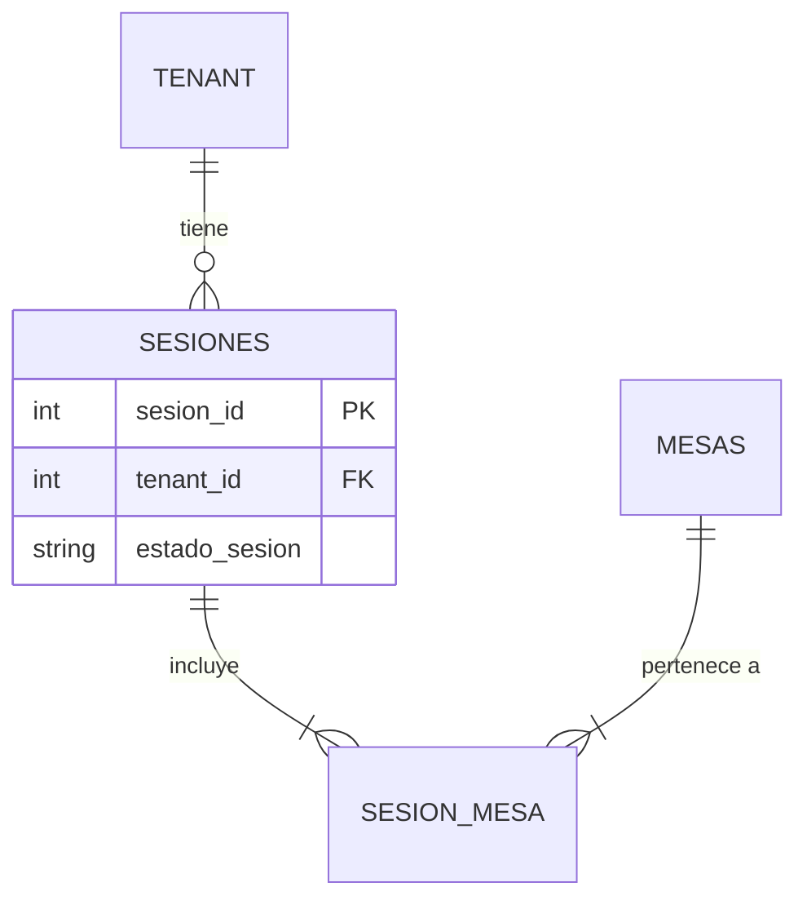

# DER - SaaS Gastronómico

## BASES CENTRALES (Estructura Core para cualquier SaaS)

### 1. TENANT (Organizaciones)

La raíz absoluta del sistema. Representa al cliente/restaurante que contrata el servicio. Todas las tablas operativas dependerán de esta.

- **tenant_id** (PK)
- **nombre_fantasia**: VARCHAR(100) - Nombre público del local (ej: "Mostachos").
- **subdominio**: VARCHAR(100) - Ruteo dinámico para el frontend (ej: "mostachos-baby").
- **plan_id** (FK): Vincula la suscripción contratada por el cliente.
- **estado**: BOOLEAN - Baja lógica

### 2. ROLES (Catálogo de Accesos)

Define los niveles de acceso estáticos del sistema.

- **rol_id** (PK): Identificador único.
- **nombre_rol**: VARCHAR(50) - Ej: 'Dueño', 'Administrador', 'Cajero', 'Mozo'.
- **nivel_acceso**: INT - Jerarquía numérica para control en las rutas del backend y renderizado del frontend.

### 3. USUARIOS (Control de Acceso)

Aquí conviven los dueños, administradores y el personal del salón.

- **usuario_id** (PK)
- **tenant_id** (FK): Obliga al usuario a existir únicamente dentro de su respectivo restaurante.
- **rol_id** (FK): Apunta al nivel de permisos del usuario.
- **username**: VARCHAR(50)
- **email**: VARCHAR(100)
- **password**: VARCHAR(255)
- **estado**: BOOLEAN - Baja lógica

---

## GESTIÓN DE SUSCRIPCIONES Y LÍMITES (Base Gastronómica)

### 4. PLANES_SAAS (Niveles Comerciales)

Define los niveles de suscripción y los topes cuantitativos de recursos que el plan permite.

- **plan_id** (PK)
- **nombre_plan**: VARCHAR(50) - Ej: "Básico", "Premium".
- **precio_mensual**: DECIMAL(10,2)
- **limite_admins**: INT - Cantidad máxima de cuentas con rol Administrador/Dueño.
- **limite_mozos**: INT - Cantidad máxima de cuentas con rol Mozo.
- **limite_mesas_fisicas**: INT
- **estado_activo**: BOOLEAN - Baja lógica

### 5. MODULOS_SAAS (Catálogo de Funcionalidades Programables)

Registro estático de las funciones del software.

- **modulo_id** (PK): Identificador único relacional.
- **codigo_modulo**: VARCHAR(50) - Clave inmutable que lee Node.js (Ej: 'RESERVAS_WEB', 'UNION_MESAS', 'PAGOS_QR').
- **descripcion**: TEXT - Explicación interna de la funcionalidad.

### 6. PLAN_MODULO (Tabla Intermedia)

- **plan_id** (FK): PK Compuesta.
- **modulo_id** (FK): PK Compuesta.

---

## MÓDULO GASTRONÓMICO (Capa Operativa del Salón)

### 7. MESAS (Mobiliario Físico)

Representa la disposición física del salón. No almacena consumos, solo el inventario de lugares.

- **mesa_id** (PK)
- **tenant_id** (FK)
- **numero_mesa**: VARCHAR(10) - Permite letras si el local usa sectores (ej: "A1", "12").
- **capacidad**: INT - **(DEBATIR)** Cantidad de comensales que entran en la mesa | Cantidad de comensales actual en dicha mesa.
- **estado_fisico**: VARCHAR(20) - Ej: 'libre', 'ocupada', 'sucia'.

### 8. SESIONES (El Motor de Consumo)

Desvincula el consumo de la mesa física, permitiendo unificar mobiliario para grupos grandes. Ej: '2 o más mesas para X personas donde sólo se va a cobrar 1 solo monto.'

- **sesion_id** (PK)
- **tenant_id** (FK)
- **estado_sesion**: VARCHAR(20) - Ej: 'abierta', 'cerrada', 'reservada'.
- **fecha_apertura**: TIMESTAMP - Momento en que los clientes se sientan.
- **fecha_cierre**: TIMESTAMP (Nullable) - Momento en que se paga la cuenta.
- **codigo_reserva**: VARCHAR(20) (Nullable) - Si la sesión proviene del Módulo de Reservas, aquí se valida el código QR de entrada.

### 9. SESION_MESA (Tabla Intermedia)

Aqui es donde permitimos ocupar una o más mesas físicas para 1 sesion.

- **sesion_id** (FK): PK Compuesta.
- **mesa_id** (FK): PK Compuesta.

### 10. CATEGORIAS_MENU

Clasificación para estructurar el catálogo digital.

- **categoria_id** (PK)
- **tenant_id** (FK)
- **nombre**: VARCHAR(50) - Ej: "Hamburguesas", "Pizzas", "Bebidas".
- **orden**: INT - Define en qué posición aparece dicha categoria en la app del cliente (ej: 1ero mostramos las Bebidas, 2do mostramos la Hamburguesas, 3ero Mostramos las Pizzas, etc).

### 11. PLATOS (Catálogo Dinámico)

Vamos a utiliza las ventajas de PostgreSQL para evitar exceso de tablas relacionales en ingredientes.

- **plato_id** (PK)
- **tenant_id** (FK)
- **categoria_id** (FK)
- **nombre**: VARCHAR(100)
- **precio_base**: DECIMAL(10,2)
- **disponible**: BOOLEAN - Permite al administrador ocultar platos sin stock.
- **opciones_personalizacion**: JSONB - Campo no estructurado para guardar filtros y variantes (Ej: `{"alergenos": ["Sin TACC"], "extras": ["Extra Cheddar", "Sin Cebolla"]}`).

### 12. PEDIDOS (Cabecera de Comanda)

Representa la acción del cliente de enviar un conjunto de platos a la cocina o barra.

- **pedido_id** (PK)
- **tenant_id** (FK)
- **sesion_id** (FK): A qué cuenta (grupo de clientes) pertenece este consumo.
- **promocion_id** (FK, Nullable): Se asocia si este pedido en particular recibió un descuento.
- **estado_aprobacion**: VARCHAR(30) - Validación Human: 'pendiente_revision', 'rechazado', 'en_preparacion', 'entregado'. Aqui entra la accion del mozo/administrador que esta validando físicamente si dicho pedido es real o no.
- **fecha_pedido**: TIMESTAMP.
  Podemos acomodar en una COLA según sea aceptada la orden, estimar el tiempo aprox. de otros pedidos anteriores de la casa, o también calcular ni bien la comanda de cocina arranque a preparar ese pedido que aceptó ese sector.
- **monto_descuento**: DECIMAL(10,2)
- **total_final**: DECIMAL(10,2) - sumatoria de ítems menos el descuento.

### 13. DETALLE_PEDIDO (Los Ítems de cada pedido)

El desglose de cada plato pedido dentro de una comanda.

- **detalle_id** (PK)
- **pedido_id** (FK)
- **plato_id** (FK)
- **cantidad**: INT.
- **precio_unitario**: DECIMAL(10,2) - Se guarda para el histórico, para hacer métricas a futuro, pero el recibo de hoy no se altera.
- **notas_cliente**: VARCHAR(255) - Ej: "La carne bien cocida", "Sin sal".

### 14. PROMOCIONES (Motor de Descuentos)

Catálogo dinámico para crear campañas, convenios con tarjetas o días especiales.

- **promocion_id** (PK)
- **tenant_id** (FK)
- **nombre**: VARCHAR(100) - Ej: "Miércoles 20% con Banco X", "2x1 Happy Hour".
- **tipo_descuento**: VARCHAR(20) - Define la lógica matemática: 'porcentaje' o 'monto_fijo'.
- **valor**: DECIMAL(10,2) - Ej: 20.00 (para 20%) o 1500.00 (para descontar dinero fijo).
- **estado_activo**: BOOLEAN - Permite apagar la promo cuando termine.

## MÓDULO DE FACTURACIÓN Y PAGOS (Cierre de Cuenta)

### 15. FACTURAS_TICKETS (Resumen de la Cuenta)

Se genera en el momento exacto en que el cliente "Pide la cuenta" o el mozo la imprime. Congela los montos finales de toda la sesión para el registro contable.

- **factura_id** (PK)
- **tenant_id** (FK)
- **sesion_id** (FK)
- **subtotal_consumos**: DECIMAL(10,2) - Sumatoria total de todos los pedidos de la sesión.
- **monto_descuentos**: DECIMAL(10,2) - Sumatoria de todos los descuentos aplicados.
- **total_final**: DECIMAL(10,2) - Lo que realmente se debe cobrar (Subtotal - Descuentos).
- **fecha_emision**: TIMESTAMP - Cuándo se generó el ticket.
- **estado_factura**: VARCHAR(30) - Ej: 'pendiente_pago', 'pagada', 'anulada'.

### 16. PAGOS (Transacciones)

Registra el ingreso real del dinero. Al estar en una tabla separada (relación 1 a Muchos con la factura), permite que una misma cuenta se pague con múltiples métodos (ej: $10.000 en efectivo y $40.000 con MercadoPago).

- **pago_id** (PK)
- **tenant_id** (FK)
- **factura_id** (FK): A qué ticket contable pertenece este ingreso.
- **metodo_pago_id** (FK)
- **monto_abonado**: DECIMAL(10,2) - La cantidad de dinero que ingresó en este pago específico.
- **fecha_pago**: TIMESTAMP - Momento exacto de la transacción.

### 17. METODO DE PAGOS

- **metodo_pago_id** (PK)
- **tenant_id** (FK)
- **nombre_metodo_pago**: VARCHAR(50) - Ej: 'Efectivo', 'MercadoPago', 'Tarjeta de Débito'.
- **estado_activo**: BOOLEAN - Baja lógica

---

## 🛠️ Guía de Migración a Herramientas Visuales

Finalizada la estructura del modelo de datos en texto vamos a:

**1. Pasar las tablas a Mermaid.js**

- Permite renderizar el gráfico directamente dentro de este mismo archivo o en repositorios de código.
- Debes abrir un bloque de código y especificar `mermaid`.
- Usa la palabra reservada `erDiagram` para iniciar el gráfico y conectar las tablas.

_Ejemplo de sintaxis:_

